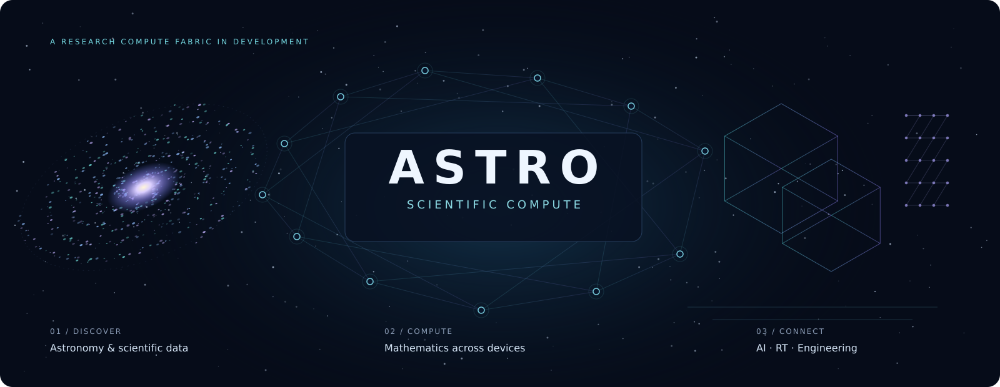
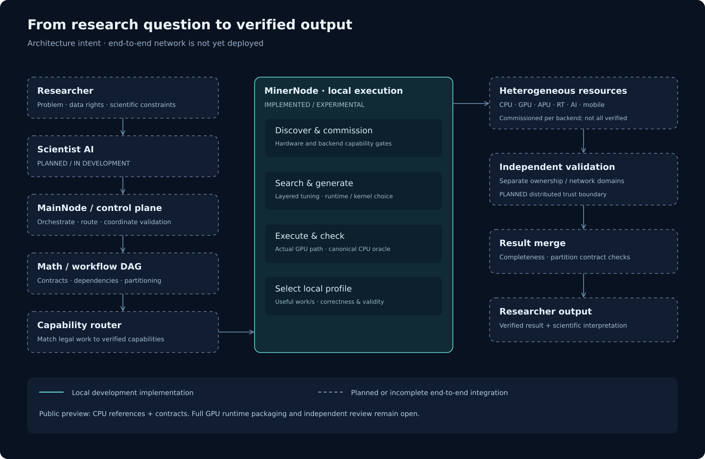

<p align="center"></p>

# ASTRO · Scientific Compute

[](https://github.com/ASTRO-Scientific-Compute/astro-compute/actions/workflows/demo-ci.yml)

**Discover hardware. Optimize execution. Validate the science.**

ASTRO is building a heterogeneous scientific compute fabric that discovers, optimizes, executes and validates mathematical workloads across CPUs, GPUs, ray-tracing hardware and AI accelerators.

Independent distributed validation is a planned network capability; local execution already uses independent mathematical reference checks within its stated scope.

**EXPERIMENTAL · Active development · Not production-ready**

[Architecture](docs/ARCHITECTURE.md) · [Current status](docs/STATUS.md) · [Mathematical corpus](docs/SCIENCE_MAP.md) · [Search & runtime](docs/SEARCH_AND_RUNTIME.md) · [Roadmap](docs/ROADMAP.md)

### ASTRO in 30 seconds

- **What:** a heterogeneous scientific compute fabric in development.
- **Why:** use different hardware for the mathematical work it performs well.
- **How:** discover → optimize → execute → validate.
- **Today:** an 81-primitive CPU reference corpus, a bounded four-MathSpec Vulkan GPU demo, native build sources and correctness CI.
- **Future:** distributed MinerNodes, MainNode, Scientist, independent distributed validation and universal mathematical composition.

### Try the GPU demo

```bash
bash run_gpu_demo.sh
```

[Install the dependencies and run the demo](docs/GPU_DEMO.md). Four fixed MathSpecs run through DIRECT and TILED kernels, compare their complete warmup/final outputs with the canonical CPU oracle, then stop. Results are **QUICK_DIAGNOSTIC_ONLY**. The included demo does not run unrestricted Census/Fusion search or a full MinerNode.

For the CPU references and software selftests (Python 3.10–3.12):

```bash
python3 -m venv .venv
source .venv/bin/activate
python -m pip install -r requirements.txt
python -m unittest discover -s tests -v
python reference_demo.py
```

**Source-available demonstration software. Free to evaluate using the included demo. All other use requires explicit permission from the copyright holder.** See [LICENSE](LICENSE), [licensing scope](LICENSING.md) and [completed validation](docs/PUBLICATION.md). This is not an open-source or OSI-approved license.

## 1. What is ASTRO?

**PLANNED platform; EXPERIMENTAL local execution.** ASTRO connects a research problem to a mathematical contract, a hardware-compatible execution plan and a checked result. “MinerNode” means a compute worker. Scientific work, rather than cryptocurrency proof-of-work, is the purpose of the system.

## 2. Why heterogeneous scientific compute?

**PLANNED network architecture.** Different devices have different strengths. An older GPU may handle FFT, reduction, geometry or data preparation while an AI accelerator handles an appropriate matrix workload. CPUs, APUs, AMD/NVIDIA/Intel GPUs, RT-capable devices and, eventually, mobile/edge devices should be routed by measured capabilities. A device name or advertised feature never proves a working execution path.

## 3. Architecture



The complete Researcher → Scientist → MainNode → worker → independent validation loop is **PLANNED / IN DEVELOPMENT**, not a deployed production network. The solid local block identifies the experimental development implementation; it does not imply that the whole GPU runtime ships in this public preview. [Read the boundaries](docs/ARCHITECTURE.md).

## 4. MinerNode

**IMPLEMENTED / EXPERIMENTAL in the development tree:** local capability inspection, candidate generation, kernel execution, correctness checks and local profile selection. There is no universal hardcoded GPU winner. The reference development device is AMD BC-250 / RADV GFX1013; its active CU count is a runtime capability, not a cross-device constant. Full cross-vendor execution coverage is **UNAVAILABLE** as a verified claim.

## 5. Runtime Fusion

**EXPERIMENTAL.** A job can combine batching, in-flight work, resident data, command reuse and asynchronous host work. Correctness belongs to the complete runtime configuration. Native independent-job fusion currently covers a smaller subset than the canonical reference corpus. Bounded persistent job loops are not an unlimited GPU scheduler. Transfer/compute overlap and independent multi-machine execution are not established. [Mechanism-by-mechanism status](docs/SEARCH_AND_RUNTIME.md).

## 6. Hardware profiling

**IMPLEMENTED catalog and search-path model; EXPERIMENTAL execution integration.** Capability Census distinguishes storage, scalar, vector, packed/dot, matrix/tensor and emulated paths across numeric formats. FP64/32/16, BF16, FP8/6/4 and INT64/32/16/8/4 are not interchangeable claims. Documentation, backend exposure, an executed kernel and trustworthy measurement are separate evidence levels. Resource measurements such as final VGPR/SGPR allocation, scratch/spill and occupancy remain **UNAVAILABLE** where the driver supplies no reliable receipt. SPIR-V is not a register-allocation oracle.

## 7. Layered search

**IMPLEMENTED / EXPERIMENTAL in the development tree.**

`BATCH → RUNTIME → WAVE_SUBGROUP → ILP → LOCAL_SIZE → TILE → PACK → UNROLL → EXECUTION_FAMILY → SPECIAL_PATH → MINI_REFINE → QUICK_CONFIRM`

Each layer builds on the previous correctness-PASS configuration and introduces one new search dimension. Legal unexplored axes get an exploration trial before policy pruning; unavailable axes are reported explicitly. ILP is currently unavailable as an independent axis in the audited Fast V2 adapter set. A QUICK winner remains a local candidate, not a production promotion. [Audit rules](docs/SEARCH_AND_RUNTIME.md).

## 8. Universal Mathematics

**IMPLEMENTED reference corpus; PLANNED general composition.** The development registry has 94 entries; this preview includes 81 canonical CPU reference primitives, including 66 SPACE entries. Those numbers describe different scopes. The remaining 13 entries are listed explicitly in the [inventory](registry_inventory.json).

The long-term goal is to compose reductions, transforms, sparse/dense operations, scans, gather/scatter, integration, geometry, tensor operations and spatial traversal into research workflows. The corpus is a reference and regression foundation, not a promise to solve science by accumulating hundreds of unrelated handwritten recipes.

## 9. Science domains

| Domain | Implemented reference examples | Planned direction beyond the bounded primitives |
|---|---|---|
| SPACE | Image moments, catalog geometry, FFT/correlation, photometry, orbital primitives | Composed astronomy, Gaia/catalog workflows, gravitational-wave processing |
| BIO | Alignment scores, contact analysis, numerical primitives | Larger biological workflows |
| CHEM | Squared pair distances, radial counts, geometry | Composed molecular/spatial analysis |
| PHYSICS | Ising observables, bounded numerical primitives | Simulation and field/particle workflows |
| SIGNAL | FIR and spectral/numerical building blocks | Composed filtering and signal pipelines |
| ENGINEERING | Sparse matrix-vector products, orientation, numerical geometry | Simulation, optimization and realtime workloads |

Two additional canonical RT commissioning contracts are categorized separately. A primitive is not a complete scientific application. [Full 94-entry inventory and scope](docs/SCIENCE_MAP.md).

## 10. Validation

**Correctness before performance.** Exact/COLD ZERO contracts require zero differing bits; bounded-FP contracts retain their own explicit bounds. An optimization cannot silently change the mathematical problem, rounding graph or input representation.

Two separate gates matter: **implementation agreement** checks the entire GPU output against the independent CPU implementation (zero differing bits for exact contracts); **scientific validity** checks the numerical result against the required scientific reference, higher internal precision or original error budget where the MathSpec requires it. Two implementations agreeing bit-for-bit does not prove that both implement the intended science correctly. The documented [Hann FFT / whitening amendment](docs/VALIDATION.md#historical-example-hann-fft-and-whitening) illustrates why.

The public CPU checks are **VERIFIED only within their stated test scope**. Development GPU results need their own oracle comparison, executed-path evidence and performance-validity gates. Independent network validation is **PLANNED**: nodes sharing an ownership or network domain do not automatically count as independent validators. [Validation policy](docs/VALIDATION.md).

## 11. RT compute

**EXPERIMENTAL local paths.** Ray query and BLAS/TLAS traversal can serve conservative spatial broadphases. A candidate hit must still satisfy the MathSpec's exact narrowphase. RT is not assumed to accelerate every workload. Ray-query commissioning does not establish general raygen/SBT support or an application-wide speedup.

## 12. AI / Tensor

ASTRO is scientific compute first. AI/Tensor execution, Scientist AI and orchestration are components within that system, not its primary definition.

**PLANNED execution integration.** Tensor/matrix work, inference, preparation and distributed reasoning support belong behind capability and correctness gates. Cataloging FP4 or BF16 does not mean that a given GPU executes it natively. Legacy GPUs remain useful for suitable classic compute tasks; modern accelerators must prove their own paths. No production inference/training backend is claimed here.

## 13. Engineering / Realtime / Game

**EXPERIMENTAL separate prototype; PLANNED ASTRO integration.** An existing Linux game-optimizer prototype observes launch/API paths and frame-time metrics, stores per-game profiles and supports restricted launch-setting experiments and rollback on a later launch. No verified game-speedup claim is published here.

The ASTRO direction is **ANALYZE → RECOMMEND → AUTO-APPLY**, with explicit validation and rollback. Automatic frame-graph reconstruction, engine/shader rewriting and physics/RT pipeline optimization are planned. [Prototype boundary](docs/ENGINEERING.md).

## 14. MainNode

**PLANNED / IN DEVELOPMENT.** The control plane is responsible for DAG dependencies, routing, data distribution, validation coordination, result collection, receipts, node management and researcher interfaces. The local uploader simulator is not a real result-receipt service. No unmeasured node-capacity claim is made.

## 15. Scientist

**PLANNED / IN DEVELOPMENT.** Scientist AI would interpret the research task, propose a mathematical workflow, dispatch compute through MainNode, assess validated outputs and reconstruct a researcher-facing answer. Mathematical correctness and scientific interpretation remain distinct responsibilities.

## 16. Storage and data lifecycle

**IMPLEMENTED benchmark retention policy; research ACK integration IN DEVELOPMENT.**

- Benchmark: **run → validate → profile → cleanup**. Retain the compact profile, not raw outputs, hash inventories, telemetry dumps or trial workspaces.
- Research work: **compute → validate → upload → verified MainNode ACK → grace period → local delete**. A simulated upload never authorizes deletion.

Storage planning guidance: **512 GB SSD minimum recommendation; 1 TB+ recommended**, depending on researcher data and workload. This is not a measured minimum requirement or a reason to accumulate benchmark debris. [Lifecycle details](docs/DATA_LIFECYCLE.md).

## 17. Current status

**EXPERIMENTAL, not production-ready.** Fast Search works on bounded adapters in the development tree; Runtime Fusion is under active development. The image-moments runtime path has an unresolved intermittent correctness failure; successful replays do not prove it fixed. Native resource receipts, full cross-vendor execution validation and independent review remain open. [Dated status table](docs/STATUS.md).

## 18. Benchmarks

This preview publishes **no GPU performance leaderboard**. Historical local profiles are not self-contained public reproduction packages. Primary metrics must be correctly completed natural work units/s and end-to-end time; legacy science/s is secondary. QUICK, confirmed local, sustained, certified and historical results must remain distinct. [Required methodology](docs/BENCHMARKS.md) · [External reproduction template](docs/EXTERNAL_REPRODUCTIONS.md).

## 19. Roadmap

**NEXT milestones:** broader portable GPU search integration and external human review; broader hardware commissioning; resource evidence; reliable runtime composition; a real MainNode ACK and independent validation protocol; Scientist integration; host-runtime generation; heterogeneous network commissioning; engineering/realtime integration. Marketplace, compensation, accounting/token and fiat-denominated research contracts are long-term design topics, not operational products. [Gated roadmap](docs/ROADMAP.md).

## 20. Contributing

Start with [CONTRIBUTING.md](CONTRIBUTING.md). Small reproducible correctness cases, independent reviews, precise capability gaps and portable packaging improvements are useful. Code modification and contribution require prior written permission; contribution terms must be agreed before incorporating third-party code.

## 21. Security

Read [SECURITY.md](SECURITY.md). Never submit credentials, private researcher data or raw local state in a public issue. Security reporting must use a confirmed private channel. This preview starts no network service and does not expose a production compute network.
