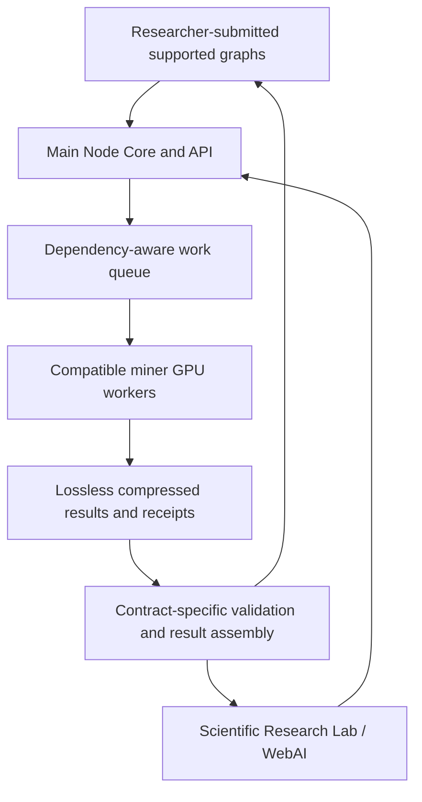

# Shared ASTRO architecture — 2026-11-19

ASTRO's Scientific Research Lab and direct Scientific Compute Network use the same execution foundation. WebAI is a service interface to this foundation. Researcher jobs can also enter without an AI planner.

The diagram is the intended end-to-end service relationship. It is not a deployment or general scientific capability certificate.

## Implemented local foundation

The private system has a typed mathematical graph representation, CUDA/Vulkan execution, bounded memory windows and a durable dependency-aware packet queue. Workers claim eligible work when capacity is available; independent ready packets need not wait for another GPU's unrelated work. Dependencies, ownership and revisions still constrain valid execution.

A BC-250 Main Node and a second host completed a bounded four-worker test with 12 three-matrix synthetic DAGs. This qualifies that particular packetized route. It does not establish automatic partitioning of every Transformer or arbitrary scientific workflow. [Network evidence](measurements/MAIN_NODE_2026-11-19.md).

A later private Core/API integrates a resident model worker through the same queue. Its finite test used a complete 426,688-parameter model; the separately trained 124M model was not served by that campaign. Multiple scientific owners, cancellation and controlled service restart were checked. Broader deployment, concurrent WebAI service and state migration remain separate gates.

## Service responsibilities

| Component | Responsibility | Current boundary |
|---|---|---|
| Web / researcher API | Submission, ownership and result presentation | Public service PLANNED; private API checks exist |
| Scientific Research Lab / WebAI | Interpret requests, propose workflows, consume checked results | Useful autonomous research and conversation not established |
| Main Node Core | Admission, quotas, dependencies, leases, receipts and service state | Private finite qualifications; not a public trust or failover qualification |
| Graph Planner | Validate supported operations and produce legal bounded work | Partial graph-family coverage; all-operation partitioning PLANNED |
| Miner | Execute assigned supported work using actual capabilities and local resource bounds | Current private CUDA/Vulkan paths; does not require the full WebAI application |
| Validator / result assembly | Check the mathematical contract and reconstruct complete outputs | Independent local oracles exist; adversarial multi-owner validation PLANNED |

Different service classes require distinct owners, quotas and priorities. A submission queue may exceed the number of concurrently resident jobs; admission and scheduling must bound RAM, VRAM, compilation and retained data. One researcher must not starve another. General long-duration fairness under skewed workloads remains a qualification target.

## Data and correctness

Current supported GPU result paths use mandatory lossless QGP1 packaging before full result readback. In the first network test the gateway forwarded compressed dependency objects without decoding their arrays; downstream workers decoded inputs on the CPU before upload. This does not prove a completely GPU-only input path or net CPU savings from compression.

Independent reference calculations belong to qualification and validation, not to every production workload's input requirements. Researchers need not supply a precomputed answer. The mathematical contract must define how outputs can be checked; transport integrity alone cannot establish scientific correctness.

Hardware acceleration is a capability- and contract-dependent route. Tensor/RT support, successful compilation and high power consumption are not interchangeable evidence of useful throughput. Automatic selection must satisfy correctness and be judged on the measured execution boundary, with explicit resource budgets.

## Public/private boundary

The repository contains the licensed public demo, historical documentation and the already published November 8 miner archive. This update adds no current private engine, planner, scheduler, model, compiler, kernel generator or optimization implementation. It makes no new code-release commitment.

The [previous architecture](https://github.com/ASTRO-Scientific-Compute/astro-compute/blob/ad6dff7c263c1a2845f604267092c68725f0c39f/docs/ARCHITECTURE.md) and [detailed historical acceptance gates](ARCHITECTURE_ROADMAP.md) remain available at their original scope. No operational marketplace, token economics or general network capacity is announced.
